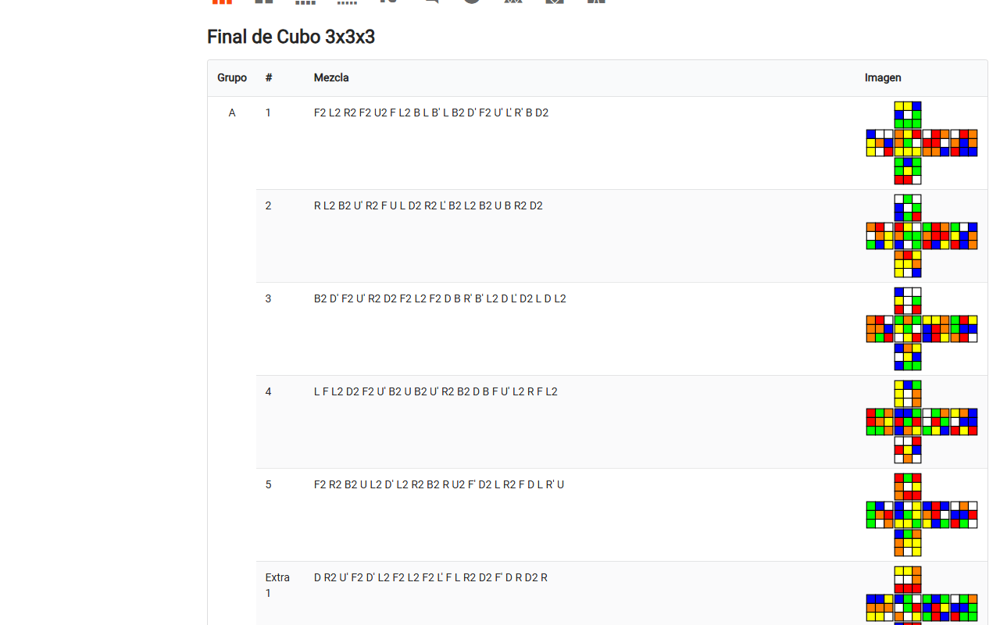
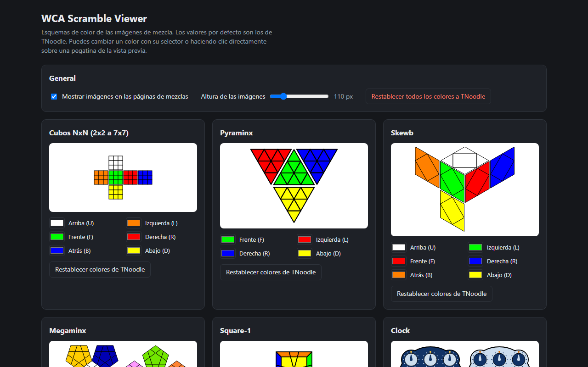

# WCA Scramble Viewer

Extensión de Chrome que, en las páginas de mezclas de las competiciones de la WCA
(`https://www.worldcubeassociation.org/competitions/<ID>/scrambles`), añade una columna
**Imagen** con el estado del puzzle tras aplicar cada mezcla, dibujado igual que en TNoodle.
Sirve para comprobar de un vistazo que un puzzle está bien mezclado.

## Categorías

2x2 a 7x7, 3x3 OH, BLD (3x3, 4x4, 5x5), FMC, MBLD, Pyraminx, Skewb, Megaminx, Square-1 y Clock.

## Colores

- Por defecto se usan los esquemas de color de TNoodle.
- **En la propia página**: haz clic en cualquier pegatina para cambiar el color de esa cara
  (se aplica a todas las imágenes de ese puzzle y se guarda).
- **Página de opciones** (botón «Personalizar colores…» del icono de la extensión): vista previa
  de cada puzzle, selector de color por cara y botones para restablecer.
- Los cubos 2x2–7x7 comparten un mismo esquema.
- Los ajustes se guardan con `chrome.storage.sync`, así que te siguen entre equipos con tu cuenta de Chrome.

## Instalación desde el código

1. Descarga o clona este repositorio.
2. Abre `chrome://extensions` y activa **Modo de desarrollador** (arriba a la derecha).
3. Pulsa **Cargar descomprimida** y elige la carpeta `wca-scramble-viewer`
   (la que contiene `manifest.json`).
4. Abre o recarga una página de mezclas de una competición.

Si cambias algún archivo, pulsa el botón de recargar de la extensión en `chrome://extensions`
y recarga la página.

## Estructura

| Ruta | Para qué sirve |
| --- | --- |
| `wca-scramble-viewer/puzzles.js` | Simuladores y dibujo SVG de cada puzzle (portados de TNoodle) |
| `wca-scramble-viewer/content.js`, `content.css` | Inserta las imágenes en la página de la WCA |
| `wca-scramble-viewer/settings.js` | Carga y guarda los ajustes |
| `wca-scramble-viewer/picker.js` | Selector de color al pulsar una pegatina |
| `wca-scramble-viewer/popup.*`, `options.*` | Popup del icono y página de colores |
| `package.ps1` | Genera `dist/wca-scramble-viewer-<versión>.zip` para la Chrome Web Store |
| `store/` | Textos y capturas para la ficha de la tienda |

## Publicar una versión nueva

1. Sube el número de `version` en `wca-scramble-viewer/manifest.json`.
2. Ejecuta `powershell -ExecutionPolicy Bypass -File package.ps1`.
3. Sube el zip de `dist/` en el panel de desarrollador de la Chrome Web Store.

## Licencia

GPL-3.0 (ver [LICENSE](LICENSE)). La lógica de los puzzles y la geometría de los dibujos están
portadas de [tnoodle-lib](https://github.com/thewca/tnoodle-lib), que también es GPL-3.0.

Extensión no oficial: no está afiliada a la World Cube Association.
